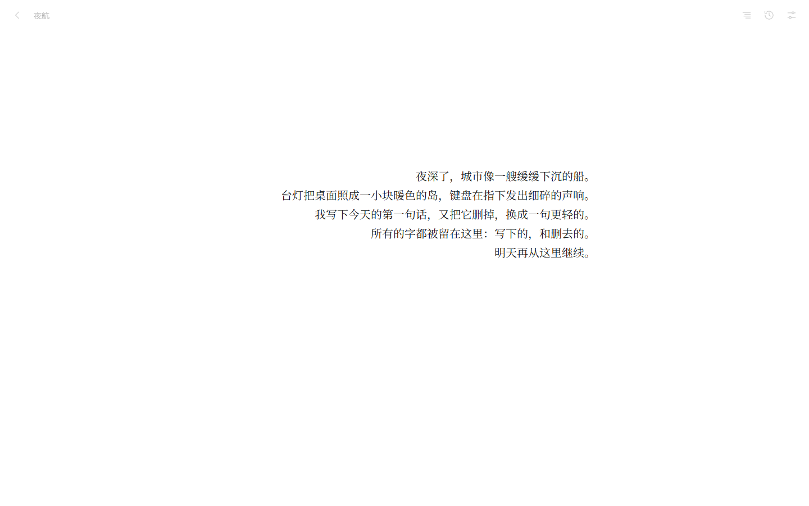
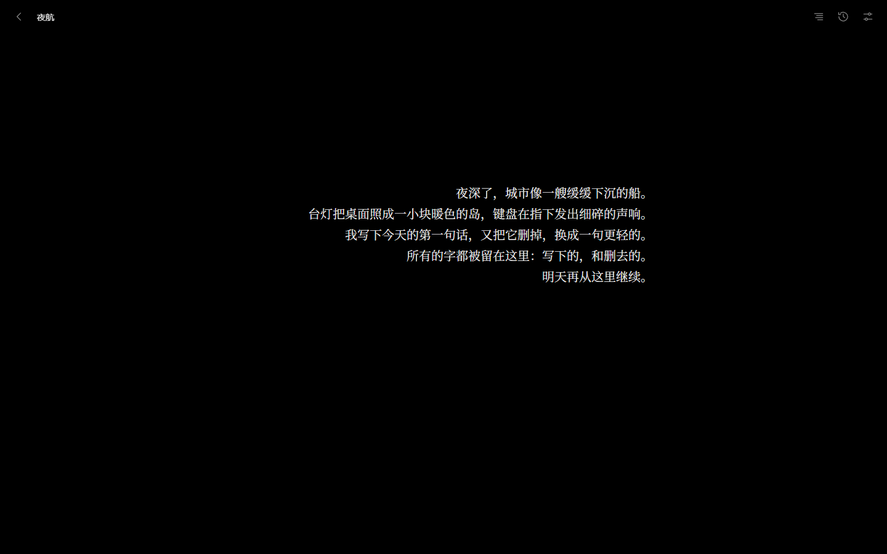
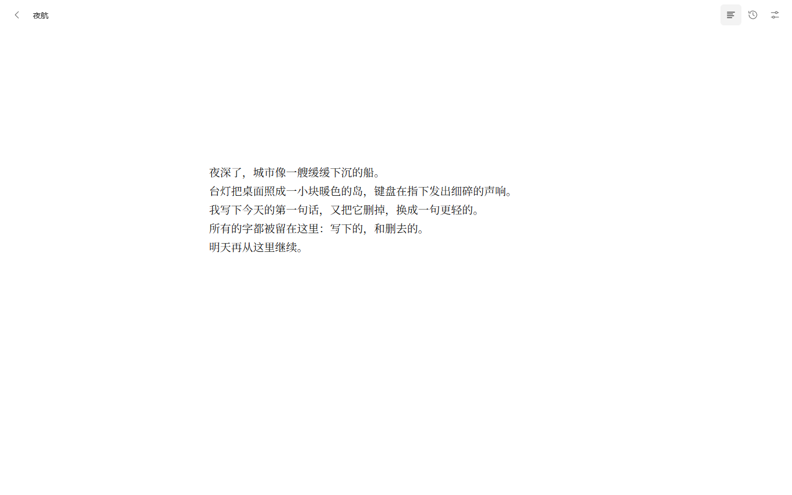
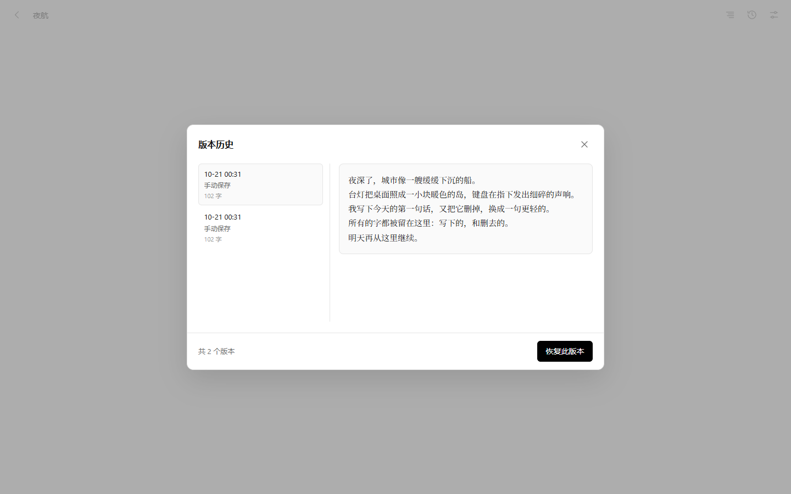
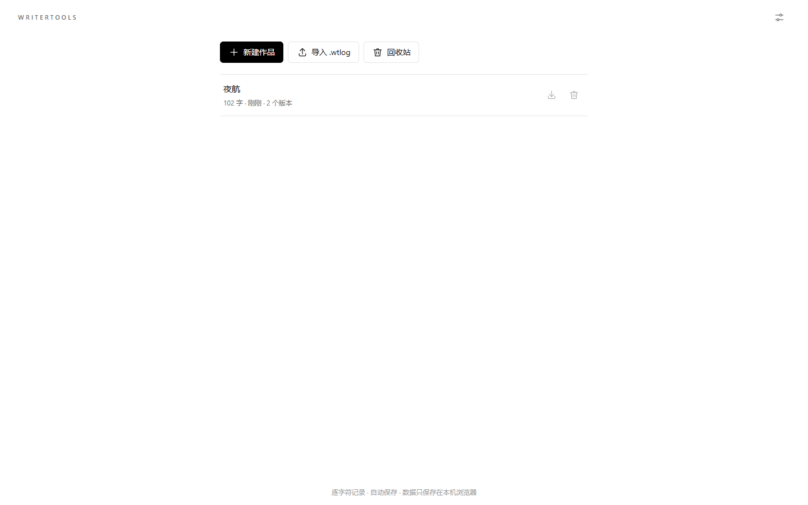
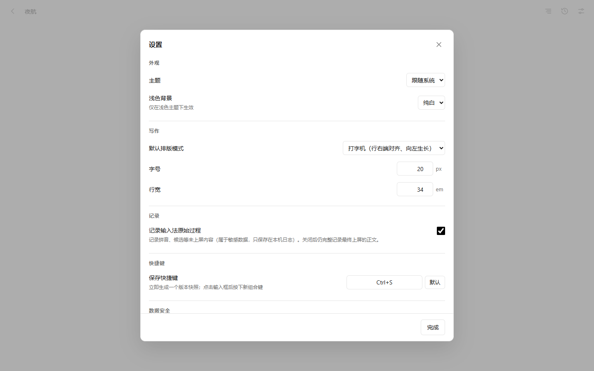
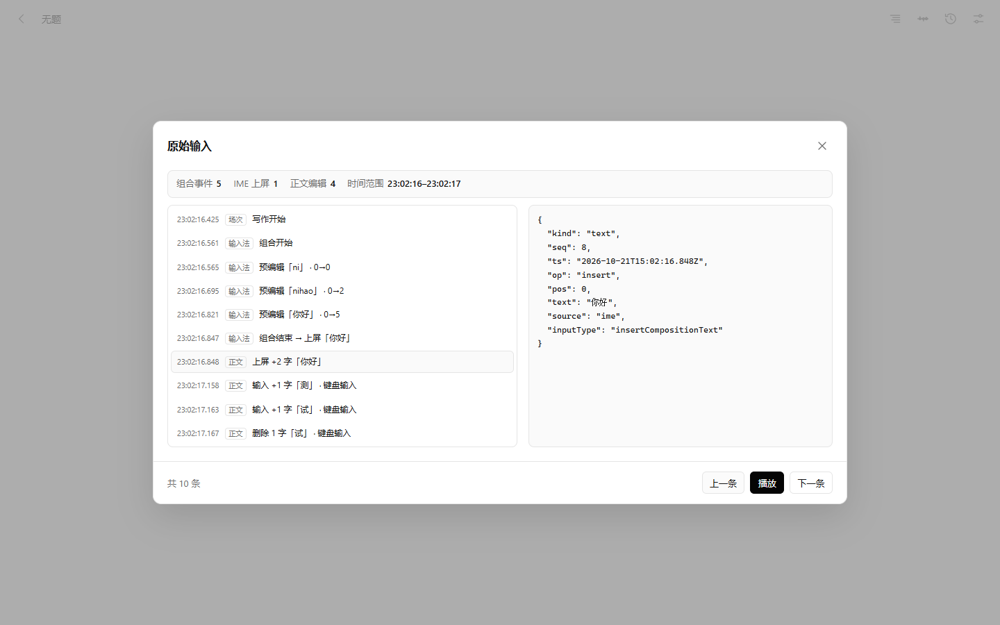

# WriterTools

极简跨平台打字机写作工具（Web / PWA）。核心只有一件事：把「写」的过程完整、可追溯、可恢复地记下来。

- **逐字符实时记录**：每一次插入、删除、替换都作为事件即时落盘；删除的**位置与被删内容**完整保留。
- **输入法原始过程（可选）**：拼音等预编辑串以 `compose.*` 事件记录，可在设置中关闭（关闭只影响输入法过程，不影响正文记录）。
- **原始输入回放/查看**：编辑器右上角打开「原始输入」面板，按时间线查看每一次拼音/预编辑变化、上屏文字、输入/删除/粘贴等正文编辑，支持自动播放与单步回看，并可点开看原始事件字段。
- **追加式日志格式（WTL v1.0）**：只增不删、哈希链可校验、向下兼容；一个作品 = 一个 `.wtlog` 文件。
- **打字机 / 居中双模式**：打字机模式行右端对齐、光标垂直居中；居中模式为常规排版。
- **明暗跟随**：跟随系统明暗，纯黑背景；浅色为纯白或奶白（可选），界面只用中性色。
- **可恢复版本历史**：手动保存快照，可预览、可一键恢复；恢复同样以追加事件实现，历史不丢。
- **本地多副本 + 启动自动恢复**：IndexedDB 主存储 + OPFS 镜像 + 可选备份目录；每次启动后台自动扫描镜像，主存储事件缺失/被截断时会自动从镜像补回并提示，不需要用户手动操作。多标签页同时打开时自动恢复会跳过被其它标签页写入的作品，避免并发冲突。
- **全量备份包**：一键把所有作品（含回收站）导出为单个 `.wtzip`（ZIP 容器，内含校验清单与每篇 `.wtlog`），可跨设备迁移或在灾备时整包恢复；导入按「只增不删」合并，分歧只报告不覆盖。
- **备份目录灾备恢复**：浏览器数据全部丢失后，重新选择备份目录、点「从备份目录恢复」，即可把磁盘上自动备份的 `.wtlog` 全部恢复回书架（先校验、只追加、不覆盖更新副本）。
- **Android APK**：可直接安装的安卓包；通过 Android 系统文件夹选择器选择手机上的备份目录（SAF 持久授权），自动备份与「从备份目录恢复」在 App 内同样可用。卸载 App 会清空应用沙盒数据，但备份目录里的 `.wtlog` 文件会保留。
- **PWA**：可安装到桌面或安卓主屏幕，缓存应用壳后可离线打开（数据本来就在本地）。

> 状态：v0.2.1，功能可用但仍在完善；文件格式已定稿并由金标准文件守护向下兼容，见 [docs/FILE-FORMAT.md](docs/FILE-FORMAT.md)。使用说明见 [docs/USER-GUIDE.md](docs/USER-GUIDE.md)。

## 界面预览

极简、无彩色、输入区始终在屏幕正中；打字机模式行右端对齐、向左生长，居中模式为常规排版。

| 打字机模式（浅色） | 打字机模式（深色） |
| --- | --- |
|  |  |

| 居中模式 | 版本历史 |
| --- | --- |
|  |  |

| 书架 | 设置 | 移动端 |
| --- | --- | --- |
|  |  |  |

**原始输入回放/查看**（编辑器右上角入口）：按时间线查看拼音/预编辑变化、上屏与删除记录，支持播放与单步。



## 快速开始

需要 Node.js 22+。

```powershell
npm install
npm run dev        # 开发服务器 http://localhost:5173
npm run build      # 类型检查 + 生产构建（输出 dist/）
npm run preview    # 预览生产构建 http://127.0.0.1:4173
```

质量检查：

```powershell
npm test           # 引擎单元测试（Vitest，含 v1.0 金标准文件兼容性回归）
npm run typecheck  # TypeScript 类型检查
npm run e2e        # Playwright 端到端冒烟（使用系统 Chrome，不下载浏览器）
npm run check:log -- <文件.wtlog>   # 独立日志格式校验器
npm run check:zip -- <文件.wtzip>   # 独立全量备份包校验器
npm run export:training -- <文件/目录> --out training.jsonl  # 导出训练 JSONL（见 docs/TRAINING-DATA.md）
npm run smoke:ui -- --headed        # Lead 独立浏览器验收（需先起 dev/preview，见脚本注释）
```

日志格式校验器 `tools/wtlog-check.mjs` 与备份包校验器 `tools/wtzip-check.mjs` 都不依赖引擎代码、独立实现规范，可校验任意 `.wtlog` / `.wtzip`（退出码 0 表示合规），适合人工核对导出文件或排查损坏。

训练数据导出工具 `tools/wtlog-to-training.mjs` 把日志转换为训练用 JSONL（文本操作、删除原文、输入法过程、场次等），详见 **[docs/TRAINING-DATA.md](docs/TRAINING-DATA.md)**。

`npm run e2e` 会检查构建产物（源码比 `dist/` 新或 `dist/` 缺失时自动构建），按需启动 `npm run preview` 并在结束后关闭；也可先自行启动 preview，再设置 `BASE_URL` 复用：

```powershell
$env:BASE_URL = 'http://127.0.0.1:4173'; npm run e2e
```

## PWA 安装

Service Worker 只在**生产构建**中注册（`npm run build` + `npm run preview`，或部署后的站点）；`npm run dev` 不注册，以免缓存干扰开发。

- **桌面 Chrome / Edge**：打开站点后，地址栏右侧出现安装图标，点击安装；或菜单 →「安装 WriterTools」。
- **安卓 Chrome**：菜单 →「添加到主屏幕」/「安装应用」。
- **离线使用**：首次打开并让 Service Worker 完成缓存后，断网仍可打开应用壳；正文与历史保存在浏览器本地存储中。

## Android APK

Android 包用 Capacitor 把同一套 Web 应用装进原生 WebView，可直接安装使用：

```powershell
npm install
npm run build
npx cap sync android
cd android
# 需要 JDK 21 + Android SDK 36；Windows 下：
# gradlew.bat assembleDebug
```

产物：`android/app/build/outputs/apk/debug/app-debug.apk`（debug 签名，可直接侧载；正式分发需配置 release 签名）。

- 备份目录通过 **Android 系统文件夹选择器（Storage Access Framework）** 选择，URI 授权持久化，重启 App 后仍然有效；自动备份、从备份目录恢复与浏览器版一致。
- App 数据在 WebView 沙盒（IndexedDB + OPFS）内，卸载 App 会清空沙盒数据（备份目录里的文件不受影响）。
- 受 WebView 下载能力限制，`.wtzip` / 单篇 `.wtlog` 的「导出下载」在 APK 内暂不可用；请用浏览器版导出，或依赖备份目录。

## 数据安全模型

数据安全优先，所有操作可恢复：

| 层 | 位置 | 作用 |
| --- | --- | --- |
| 主存储 | IndexedDB（库 `writertools`） | 编辑事件实时追加，刷新/重启浏览器后仍在 |
| 冗余镜像 | OPFS（源私有文件系统） | 冗余副本；主存储损坏时可按最长有效前缀恢复 |
| 备份目录 | 用户选择的文件夹（桌面 Chromium 用 File System Access；Android APK 用系统文件夹选择器） | 生成 `.wtlog` 副本与 `writertools-manifest.json` 清单，形成外部锚点 |
| 全量备份包 | 用户下载的 `.wtzip` 文件 | 单个文件包含全部作品与校验锚点，可离线保存到任意位置或网盘 |

- **只追加**：日志只允许在末尾追加事件，不得改写、删除、重排历史行。
- **启动自动恢复**：每次打开应用，后台扫描 OPFS 镜像；主存储事件缺失或被截断时自动补回（页面加载不阻塞），并提示「已从镜像恢复 N 个作品」；副本之间存在分歧时只提示、不自动覆盖，交由「设置 · 校验全部」处理。
- **备份目录自动备份**：在设置里选择一次备份目录后，每次保存版本、关闭作品以及应用启动时都会自动把全部作品的真实 `.wtlog` 文件与 `writertools-manifest.json` 写入该目录（约 3 秒防抖、最小间隔 15 秒），不需要再手动点「立即备份」。
- **从备份目录一键恢复**：如果浏览器数据全部丢失，重新选择同一个备份目录后点「从备份目录恢复」，应用会先校验清单与每个 `.wtlog`，再按「只追加、不覆盖更新副本、分歧只报告」的规则把作品恢复回书架；本地库为空时不会用空清单覆盖灾备清单。
- **备份权限健康检查**：浏览器重启或权限被撤销后，启动时会提示「备份目录需要重新授权，自动备份已暂停」，设置里有「重新授权备份目录」按钮，一键恢复自动备份并补写离线期间的快照；权限不足期间自动备份暂停、不静默失败、不影响书写。
- **哈希链**：每行带 `prev` / `hash`（SHA-256），单点篡改、删行、乱序都会被校验发现；备份清单的 `lastSeq` / `lastHash` / `fileHash` 作为外部锚点，可发现整段截断或整体重写。
- **删除即留档**：删除的内容保存在事件的 `deleted` 字段里，永远可追回；作品删除进回收站（软删除），不物理删除日志。
- **恢复不改历史**：恢复到旧版本会追加 `text.reset` + `snapshot` 事件，原有历史完整保留。
- **手动导出/导入**：作品可导出为 `.wtlog`（追加式日志原文）或纯文本；全部作品可导出为 `.wtzip` 备份包；导入 `.wtlog` / `.jsonl` / `.wtzip` 时若 `docId` 冲突不会覆盖现有作品，备份包按前缀只追加合并、分歧只报告。
- 威胁模型：防意外损坏、误删、部分数据丢失与普通篡改；**不承诺**对抗拥有本机完全控制权的恶意程序。

完整格式规范（信封、哈希算法、事件类型、快照、回收站、兼容规则）见 **[docs/FILE-FORMAT.md](docs/FILE-FORMAT.md)**，这是实现的最高依据。

## 快捷键

| 操作 | 默认 | 说明 |
| --- | --- | --- |
| 保存快照 | `Ctrl+S` / `⌘S` | 在设置中可自定义（需包含 Ctrl / Alt / ⌘），改后旧组合键不再触发 |
| 返回书架 | `Esc` | 有弹层/确认框时先关闭弹层 |

界面文字为简体中文，编辑器与书架均可鼠标操作；移动端按触摸布局适配。

## 项目结构

```
index.html               应用入口 HTML
src/
  main.tsx               挂载 React，生产环境注册 Service Worker
  engine/                纯 TypeScript 引擎（不依赖 UI）
    types.ts             公共契约（UI 与引擎唯一接口）
    ...                  事件日志、规范化 JSON、哈希链、IDB/OPFS、快照、校验恢复
  ui/                    React 界面：书架、编辑器、版本历史、设置、录制器、样式
  platform/              Capacitor 平台桥（Android SAF 备份目录插件适配）
android/                 Capacitor Android 工程（BackupFolder SAF 插件 + 图标/启动图）
docs/FILE-FORMAT.md      WTL v1.0 日志文件格式规范
public/
  manifest.webmanifest   PWA 清单
  sw.js                  Service Worker（导航 network-first + 静态资源 stale-while-revalidate）
  icons/                 中性色图标（SVG + 192/512 PNG + maskable 512）
tests/
  engine/                引擎单元测试（Vitest）
  e2e/run.mjs            Playwright 端到端冒烟场景（说明见 tests/e2e/README.md）
  e2e/ACCEPTANCE-v0.2.1.md 最新端到端验收报告（v0.2.1 Android APK 备份目录 + Web 全量回归）
  e2e/ACCEPTANCE-v0.2.0.md v0.2.0 原始输入回放/查看面板验收报告（保留备查）
  e2e/ACCEPTANCE-v0.1.7.md v0.1.7 输入后立即 Esc 不丢字回归验收报告（保留备查）
  e2e/ACCEPTANCE-v0.1.6.md v0.1.6 备份权限健康检查/重新授权验收报告（保留备查）
  e2e/ACCEPTANCE-v0.1.5.md v0.1.5 失败路径韧性 + 训练数据导出验收报告（保留备查）
  e2e/ACCEPTANCE-v0.1.4.md v0.1.4 备份目录灾备恢复验收报告（保留备查）
  e2e/ACCEPTANCE-v0.1.3.md v0.1.3 备份目录自动备份验收报告（保留备查）
  e2e/ACCEPTANCE-v0.1.2.md v0.1.2 .wtzip 备份包验收报告（保留备查）
  e2e/ACCEPTANCE-v0.1.1.md v0.1.1 加固验收报告（保留备查）
  e2e/ACCEPTANCE-v0.1.md   v0.1 基线验收报告（保留备查）
```

## 已知限制（v0.2.1）

- **无云同步**：数据只在本机当前浏览器中；换设备需手动备份/导出 `.wtlog` 或 `.wtzip`。
- **备份目录自动备份需先手动选择一次目录**：之后才会自动写盘；浏览器数据丢失后需重新选择同一目录再点「从备份目录恢复」（桌面浏览器目录句柄无法跨数据丢失保留；Android APK 的 SAF 授权可跨重启保留，但卸载重装后需重选）。浏览器重启/权限被撤销时需要点一次「重新授权备份目录」，期间自动备份会暂停并给出提示。自动备份失败不会打断书写，但会记录在设置的状态里。
- **无端到端加密**：日志与备份均为明文 JSON Lines，安全性依赖设备与磁盘本身。
- **备份目录的平台差异**：桌面 Chromium 用 File System Access API；Android APK 用系统文件夹选择器（SAF）；其它浏览器仍可用 IndexedDB + OPFS 与手动导出。
- **Android APK 的限制**：卸载 App 会清空 WebView 沙盒数据（备份目录文件保留）；WebView 内暂不支持 `.wtzip` / `.wtlog` 下载导出，导出请用浏览器版；当前 APK 为 debug 签名。
- **回收站为软删除**：不自动清理，数据一直占用存储；符合「只增不删」原则。
- **多标签页编辑**：同一作品被其它标签页打开时，本标签页为只读，避免并发写冲突。
- **无日志压缩**：长历史文件会持续变大；压缩（compaction）属于后续版本能力，当前不提供。
- 建议使用较新的 Chromium 系浏览器以获得完整能力（OPFS 镜像、持久化存储、备份目录）。

## 文档

- [使用手册 / 灾备指南](docs/USER-GUIDE.md) —— 怎么用、数据在哪、丢了怎么恢复
- [文件格式规范 v1.0](docs/FILE-FORMAT.md) —— 追加式 JSONL、哈希链、兼容规则、备份包
- [训练数据导出](docs/TRAINING-DATA.md) —— 把写作过程转成训练用 JSONL
- [验收报告](tests/e2e/) —— 每个版本的真实浏览器端到端验收记录

## 路线图

- 云同步（可选、明确告知数据范围）与多设备合并
- 端到端加密（主版本格式升级，旧文件保持明文可读）
- 按键级原始数据（keyDown / keyUp 与时间间隔）作为可选扩展事件
- 分支 / 合并历史
- 日志压缩（生成新文件、保留原件与未知字段）
- 更完善的移动端与桌面打包

格式演进遵循「只增不删」：只能新增可选字段、事件类型与枚举值，不破坏旧文件可读性。
